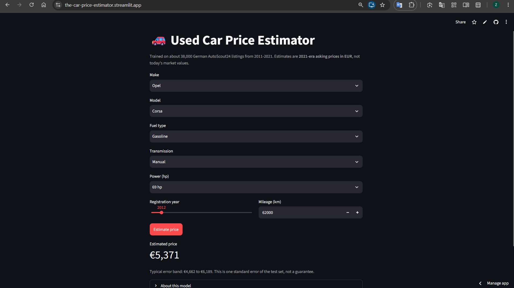

# Used-Car Price Estimator (AutoScout24, Germany)

Predicts the asking price of a used car from seven features and compares four model families. The best model, a tuned XGBoost, is deployed as a small Streamlit app.

**Live app:** https://the-car-price-estimator.streamlit.app/ | **Notebook:** `used_car_price_regression_final.ipynb`

> Estimates are **2021-era asking prices in EUR**. The data is a 2021 scrape, so this is not a tool for today's market.



## Try it

Not sure what to enter? Use this car:

| Field | Value |
|---|---|
| Make / Model | Opel / Corsa |
| Fuel / Transmission | Gasoline / Manual |
| Power | 69 hp |
| Registration year | 2012 |
| Mileage | 62,186 km |

The app should show about **€5,371**. This car is in the training data, so it is a quick demo of the app working, not a test of the model's accuracy (see the test-set results below for that).

**First load may be slow.** The app is hosted on Streamlit Community Cloud, which puts idle apps to sleep. If you see a button to wake the app up, click it and give it a moment to start.

## Data

Kaggle `ander289386/cars-germany`: about 46k AutoScout24 listings from 2011-2021 with make, model, fuel, gearbox, horsepower, mileage, registration year and price.

Cleaning (every step is logged in the notebook):

| Step | Rows removed |
|---|---|
| Exact duplicate rows | 2,140 |
| Not `Used` (new, demonstration, pre-registered, employee cars) | 5,425 |
| Missing model, gear or hp | 287 |
| hp below 30 (data errors, trailers) | 35 |
| Mileage of 0, or above 500,000 | 9 + 8 |
| Price above 100,000 EUR | 175 |
| Non-car makes | 1 |
| **Final** | **38,325 rows (17.4% removed)** |

**Scope decision:** the model targets the mainstream used market, up to 100,000 EUR. Supercars are a different market and would dominate the euro error.

## Method

- **Features:** age (`2021 - year`), mileage, hp, fuel, gearbox, make, make+model. **Target:** `log(price)`, reported back in EUR.
- **Split:** one 80/20 split (30,660 train / 7,665 test, seed 42). All tuning used 5-fold CV on the training set only. The test set was scored once.
- **Encoding:** one-hot with `min_frequency=3` inside the pipeline, so rare models are grouped using training folds only. Scaling is applied only to the linear models. Trees do not need it.
- **Winner rule, set before tuning:** a model must beat the best linear model by more than about one CV standard deviation (0.003 log-RMSE).

## Results

**Model comparison** (5-fold CV on the training set, log-price RMSE, lower is better):

| Model | CV RMSE | Notes |
|---|---|---|
| Dummy (median price) | 0.6509 ± 0.0091 | floor: the data clearly carries signal |
| Linear | 0.1529 ± 0.0022 | |
| Ridge | 0.1532 ± 0.0025 | no gain over Linear |
| CatBoost (near defaults) | 0.1544 ± 0.0033 | |
| XGBoost (untuned) | 0.1573 ± 0.0030 | behind the linear models before tuning |
| Random Forest (defaults) | 0.1664 ± 0.0036 | about 4 min per fit; the slowest and weakest |
| **XGBoost (tuned)** | **0.1443** | beats Linear by 0.0086, nearly 3x the CV noise |

Findings from the experiments:
- Boosted trees beat the linear models **only after tuning**. Deep trees (depth 7) with subsampling and L2 regularization were what helped.
- A lower `min_frequency` scored better, even for the linear model (0.1520 at 2 up to 0.1656 at 20).
- Training error was about 0.14-0.15 for every model. The 7 features set the error floor, not the model size.
- A first tuning search failed because its depth range (2-7) excluded the good region. It is kept in the notebook on purpose.

**Held-out test set** (model selected before this was scored):

| | RMSE | MAE | MAPE | R² | log-RMSE |
|---|---|---|---|---|---|
| **XGBoost (tuned)** | 2,745 EUR | 1,456 EUR | 10.5% | 0.945 | 0.1416 |
| Linear | 3,033 EUR | 1,591 EUR | 11.3% | 0.933 | 0.1492 |

The deployed file was refit on train + test, so the test numbers above are for the model *before* that refit.

## Error analysis

- **Calibration:** grouped by predicted price, mean log-residual is within ±0.005 in every price band. The pattern seen when grouping by *true* price is a selection artifact.
- **Age:** error grows from roughly 8% at 1 year old to roughly 14% at 10 years, with bias near zero.
- **What matters (permutation importance, log-RMSE increase):** hp 0.346, age 0.205, mileage 0.168, make 0.080, make+model 0.058, gearbox 0.030, fuel 0.012. hp likely acts as a proxy for segment and trim, which the data lacks (untested).
- **Rare models are harder.** Test error by number of training listings of the car's make+model:

| Training listings | Test rows | XGBoost MAPE | Linear MAPE |
|---|---|---|---|
| under 3 | 103 | 19.6% | 20.4% |
| 3-19 | 605 | 13.8% | 14.1% |
| 20-99 | 2,027 | 10.7% | 11.3% |
| 100+ | 4,930 | 9.8% | 10.8% |

XGBoost wins or ties in every bucket, and its advantage is largest on common cars. Error roughly doubles for the rarest models, but they are about 1.3% of test rows.

**Case study, Tesla (12 listings):** the model reproduces its own training listings with an average absolute error of about 17%, from -25% to +36%, much worse than the 10.5% overall. With no trim or condition data, similar listings differ a lot (two age-2 Model 3 listings asked 54,988 and 62,990 EUR with different specs). The app therefore warns about thin configurations and shows no error band for them.

## The app

Make, model, fuel, gearbox and power are a cascade of dropdowns limited to combinations that exist in the training data, so impossible cars (for example a manual Tesla) cannot be entered. The registration year is limited to the years each model appears in. Mileage is free. The error band shown under a price is one test-set error either side, and is not a guarantee.

```
pip install -r requirements.txt
streamlit run app.py
```

Files: `app.py`, `car_price_model.joblib`, `meta.json`, `requirements.txt`.

## Limitations

- Seven features. There is no trim, condition, accident history or options, so individual cars can differ a lot from the estimate.
- Asking prices, not sale prices, from a single 2021 snapshot. There is no time-based validation, and the model cannot extrapolate to older cars or today's prices.
- Near-duplicate listings (the same car with a slightly changed price) cannot be detected, only exact duplicates.
- Outlier cutoffs were chosen by looking at the full dataset before the split. They are coarse rules, not fitted parameters, so the effect should be negligible.
- CatBoost and Random Forest ran near defaults, while XGBoost got a tuning round and Ridge an alpha check. The comparison favors XGBoost slightly.
- Rare models (see the table above) are the weak spot, especially expensive ones.

## Possible next steps

- Add trim or condition features, or scrape a source that has them.
- Replace the single error band with per-coverage or quantile-based intervals.
- Try image features from the listing photos.